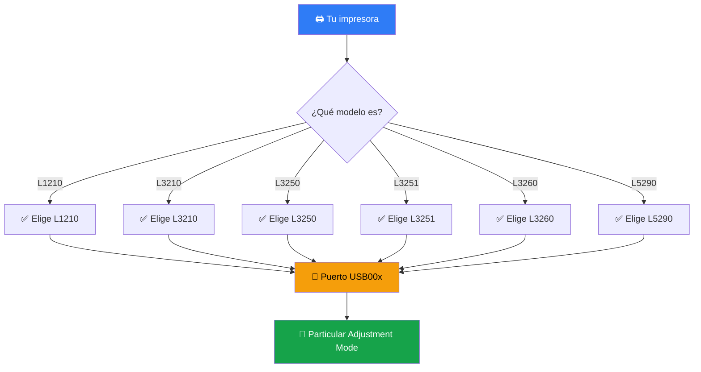

<div align="center">

# 🖨️ MANUAL DE USUARIO

## ✨ Epson Reset ✨

### 🔧 Adjustment Program / Waste Ink Pad Counter Reset


[](https://github.com)
[](https://github.github.com/gfm/)
[](./)


| 🖨️ L1210 | 🖨️ L3210 | 🖨️ L3250 | 🖨️ L3251 | 🖨️ L3260 | 🖨️ L5290 RAW |
|:---:|:---:|:---:|:---:|:---:|:---:|
| ✅ | ✅ | ✅ | ✅ | ✅ | ✅ |

> [!IMPORTANT]
> 📌 **Este manual integra TODAS las versiones que soporta la aplicación en un solo documento.** No necesitas manuales separados.

</div>

---

## 📑 Índice / Tabla de Contenido

- [🌟 1. Introducción](#-1-introducción-bienvenida-)
- [🖨️ 2. Modelos Soportados](#️-2-modelos-soportados-integrados-)
- [⚠️ 3. Requisitos y Advertencias](#️-3-requisitos-previos-y-advertencias-)
- [🔌 4. Preparación USB + Admin](#-4-preparación-conexión-usb--administrador-)
- [🚀 5. Procedimiento Paso a Paso](#-5-procedimiento-paso-a-paso-pasos-1-al-6-)
- [✅ 6. Verificación Final](#-6-verificación-final-)
- [🛠️ 7. Solución de Problemas](#️-7-solución-de-problemas-frecuentes-)
- [❓ 8. Preguntas Frecuentes](#-8-preguntas-frecuentes-faq-)
- [📞 9. Contacto y Soporte](#-9-contacto-y-soporte-)
- [🐙 10. Soporte para GitHub](#-10-soporte-para-github-)

---

## 🌟 1. Introducción / Bienvenida 🎉

<div align="center">

### 👋 ¡Bienvenido al Manual Oficial!

**`Epson Reset`** `RAW 1.0.1.1` 💎

</div>

🎯 Esta aplicación permite **restablecer el contador de la almohadilla de tinta residual** (`Waste Ink Pad Counter`) cuando tu impresora muestra:

| 🔴 Mensaje de Error | 💡 Significado |
|:---|:---|
| 🛑 `"Se requiere servicio"` / `"Service required"` | Contador al 100% 🧮 |
| 🧽 `"Almohadilla de tinta al final de su vida útil"` | Necesita reset ♻️ |
| 💡💡 `Luces de tinta y papel parpadeando alternadamente` | Bloqueo Epson 🔒 |

```diff
+ ✅ Con este procedimiento devuelves el contador al 0% y sigues imprimiendo
- ❌ Sin el reseteo la impresora se bloquea aunque tenga tinta
```

<details>
<summary>📖 <b>¿Por qué se bloquea mi Epson? (clic para ver)</b></summary>

<br>

> Epson programa un contador interno que estima cuánta tinta residual absorbió la almohadilla. Al llegar al 100% **bloquea la impresión por seguridad** para evitar derrames. El programa `AdjProg.exe` reinicia ese contador vía USB directo a la EEPROM. 🧠⚙️

- 🔢 `Main pad counter` → almohadilla principal
- 🖨️ `Platen pad counter` → platina
- 💧 `Ink system pad counter` → sistema de tinta

</details>

> [!TIP]
> 💡 **Un solo manual para todo:** `L1210` + `L3210` + `L3250` + `L3251` + `L3260` + `L5290 RAW`. ¡El procedimiento es el mismo, solo cambia el modelo que eliges en **Select**! 🎯

> [!NOTE]
> 📝 **Nota técnica:** El reseteo es por *software*. Si la almohadilla física está muy saturada (derrame visible 💧), reemplázala o instala desfogue externo con tu técnico. 🔧


## 🖨️ 2. Modelos Soportados Integrados 🎯

<div align="center">

### 🌈 ¡6 Modelos en 1 sola App! 🌈

**`RAW 1.0.1.1`** 🔥

</div>

| #️⃣ | 🖨️ Modelo | 🏷️ Serie / Tipo | 🖱️ Elegir en `Select` | 📶 Estado |
|:---:|:---|:---|:---:|:---:|
| 1️⃣ | **L1210** | 🌱 EcoTank tinta continua A4 | `L1210` |  |
| 2️⃣ | **L3210** | 🖨️ EcoTank multifuncional | `L3210` |  |
| 3️⃣ | **L3250** | 📶 EcoTank WiFi multifuncional | `L3250` |  |
| 4️⃣ | **L3251** | 🌎 Variante regional L3250 | `L3251` |  |
| 5️⃣ | **L3260** | 🔄 EcoTank WiFi + Dúplex | `L3260` |  |
| 6️⃣ | **L5290 RAW** | 🏢 EcoTank 4 en 1 + ADF + Fax | `L5290` |  |



> [!CAUTION]
> ⚠️ **¡OJO!** Si eliges un modelo incorrecto dará `Communication Error`. Verifica la etiqueta frontal o trasera de tu impresora antes de continuar. 🔍

<details>
<summary>🔍 <b>¿Dónde veo mi modelo exacto? (clic)</b></summary>

- 🏷️ Etiqueta frontal arriba de la bandeja
- 🔙 Etiqueta trasera junto al cable USB
- 🖥️ En Windows: `Panel de control > Dispositivos e impresoras`
- 📱 En la caja original

</details>

---

## ⚠️ 3. Requisitos Previos y Advertencias 🛡️

### 🖥️ Checklist de requisitos

- [x] 💻 PC con `Windows 7` / `8` / `8.1` / `10` / `11` (32 o 64 bits)
- [x] 🔌 Cable USB en buen estado, corto, a puerto **USB 2.0 trasero** (no hub)
- [x] 🟢 Impresora encendida, con papel, sin trabajos en cola
- [x] 📁 Archivos juntos: `AdjProg.exe` + `apdadrv.dll` + `StrGene.dll`
- [x] 🔕 Cerrar `Epson Status Monitor` y otros programas Epson

> [!WARNING]
> ### 🚨 ADVERTENCIA — LEER ANTES ⛔
> 1. 🔌 Usa **solo cable USB**, **NO WiFi** para el reseteo 📵
> 2. 🔒 No desconectes cable ni apagues la PC durante `Check` / `Initialize`
> 3. 👑 Ejecuta **SIEMPRE como Administrador**, si no falla el puerto `USB00x`
> 4. 🛡️ Desactiva antivirus o agrega la carpeta a exclusiones

<div align="center">

| ❌ NO HAGAS ESTO | ✅ HAZ ESTO |
|:---|:---|
| 📶 Usar WiFi | 🔌 Usar USB 2.0 directo |
| 👤 Doble clic normal | 👑 Clic derecho > Ejecutar como admin |
| 🔀 Hub USB / cable largo | 🖥️ Puerto trasero / cable corto |
| 🖨️ Imprimir a la vez | ⏸️ Cerrar todo y solo resetear |

</div>


## 🚀 5. Procedimiento Paso a Paso 🎬

<div align="center">


</div>


### 🥇 PASO 1 — Base obligatoria 🔌👑

> 🔌 Conecta `USB impresora a PC`, enciende y 👑 ejecuta como **Administrador**.

- [x] 🔌 Cable conectado
- [x] 🟢 Impresora encendida
- [x] 👑 App como administrador

### 🥈 PASO 2 — Select + Modelo + Puerto 🖱️🔌

> **Paso 2: Presionar Boton Select y elegir el modelo de Impresora Correspondiente. En Puerto hay que elegir USB00x.** 🎯

1. 🖱️ Clic en **`Select`**
2. 🖨️ Elige tu modelo: `L1210` | `L3210` | `L3250` | `L3251` | `L3260` | `L5290`
3. 🔌 Puerto `USB001` / `USB002` / `Auto`
4. 🆗 **`OK`**

```diff
+ ✅ Modelo correcto + USB00x = conecta perfecto
- ❌ Modelo incorrecto = Communication Error
```

### 🥉 PASO 3 — Particular Adjustment Mode 🚀

> **Paso 3: Pulsar sobre el boton Particular Adjustment Mode.** 🖱️✨

Se abre lista de mantenimiento. **No toques otras opciones** ⚠️


### 🏅 PASO 4 — Waste Ink Pad Counter 🧽

> **Paso 4: seleccionar Waste Ink Pad Counter.** ☑️

1. ✅ Selecciona **`Waste Ink Pad Counter`**
2. 🆗 Pulsa **`OK`**

| ☑️ Contador | 📝 Descripción |
|:---|:---|
| `Main pad counter` | 🧽 Principal |
| `Platen pad counter` | 🖨️ Platina |
| `Ink system pad counter` | 💧 Sistema tinta |

### 🔍 PASO 5 — 3 Casillas + Check 📊

> **Paso 5: seleccionar las 3 casillas y pulsar sobre el boton Check. Esperar a que muestre el porcentaje de vida.** ⏳📈

- [x] ☑️ Marca las **3 casillas**
- [x] 🔍 Pulsa **`Check`**
- [x] ⏳ **Espera** al porcentaje (ej. `100%`)
- [x] 🚫 **No cierres**, sigue al Paso 6 ➡️

> [!TIP]
> 💡 Si marca `100%` es normal: confirma bloqueo y sigue al Paso 6 😉

### 🏆 PASO 6 — 3 Casillas + Initialize + Apagado ✅🔌

> **Paso 6: Vuelve a seleccionar las 3 casillas y pulsa sobre el boton Initialize. Una vez que hayas pulsado aparecera un nuevo cuadro de dialogo: Presiona Ok y despues apaga tu Impresora, despues pulsa sobre Finish y Listo.** 🎉

| Orden | Acción | Emoji |
|:---:|:---|:---:|
| 1️⃣ | Marca **3 casillas** de nuevo | ☑️☑️☑️ |
| 2️⃣ | Clic **`Initialize`** | 🖱️✅ |
| 3️⃣ | Diálogo pulsa **`OK`** | 🆗 |
| 4️⃣ | **Apaga impresora** botón Power 10 seg | 🔌😴 |
| 5️⃣ | Pulsa **`Finish`** | 🏁 |
| 6️⃣ | Prueba impresión | 🖨️🎉 |

<div align="center">


</div>

> [!IMPORTANT]
> ✅ Al hacer `Check` de nuevo debe mostrar **`0.00%`**. Luces dejan de parpadear y lista para imprimir 🎉


## ✅ 6. Verificación Final 🧪🖨️

- [x] 🖨️ Imprime página de prueba — error debe desaparecer 🎉
- [x] 🔁 Si persiste repite Paso 5 y 6 marcando 3 casillas **AMBAS veces**
- [x] 🔌 Si no apagas cuando se pide **NO se guarda** — apagar es obligatorio ⚠️

```diff
+ ✅ 0.00% + sin parpadeo = ÉXITO
- ❌ Sigue error = repite + apaga 15 seg + Finish
```

---

## 🛠️ 7. Solución de Problemas Frecuentes 🆘

| 🔴 Problema | 🟢 Solución | Nivel |
|:---|:---|:---:|
| 🔌 No aparece `USB00x` | Cambia cable/puerto USB 2.0 trasero, reinstala driver Epson, admin |  |
| 💥 Se cierra solo | Usa `AdjProg_Win10_x64ready.exe` o `.bat`, compat WIN7RTM, exclusión antivirus |  |
| 📡 `Communication error` | Modelo incorrecto en Select (L3250 ≠ L3251) |  |
| 0️⃣ Check 0% pero sigue error | Initialize + apaga 15 seg + Finish, desconecta 1 min |  |
| 🔑 Pide key/código | Esta RAW 1.0.1.1 **no pide key**, usa exe de tu carpeta |  |
| ⬛ Ventanas negras | Aplica DPIUNAWARE vía `.bat` |  |

<details>
<summary>🧰 <b>Comandos útiles Windows (clic)</b></summary>

```powershell
# 🔄 Reiniciar spooler de impresión
Restart-Service Spooler

# 🔌 Ver puertos USB / impresoras
Get-Printer | Format-Table Name, PortName

# 🛡️ Desbloquear archivos descargados
Unblock-File -Path .\AdjProg.exe, .\apdadrv.dll, .\StrGene.dll
```

</details>

---

## ❓ 8. Preguntas Frecuentes FAQ 💬

<details open>
<summary>❓ <b>¿Sirve para todos a la vez?</b></summary>
✅ Sí, integra <code>L1210, L3210, L3250, L3251, L3260 y L5290 RAW</code> 🎉
</details>

<details>
<summary>📶 <b>¿Puedo usar WiFi?</b></summary>
❌ No, solo cable <code>USB</code> para resetear 🔌
</details>

<details>
<summary>⏰ <b>¿Cada cuánto se hace?</b></summary>
Solo cuando pida almohadilla llena (cada 20-30 mil págs aprox) 📄
</details>

<details>
<summary>🪟 <b>¿Funciona en Win 11?</b></summary>
✅ Sí, como administrador y con lanzador compatible 👑
</details>

<details>
<summary>🛡️ <b>¿Pierdo garantía?</b></summary>
No daña el equipo, pero si está en garantía consulta a Epson 📞
</details>

---

## 📞 9. Contacto y Soporte 💌

<div align="center">

### 💬 Cualquier duda contáctanos y con gusto te ayudaremos 🤝💙


| 📝 Dato | 📌 Ejemplo |
|:---|:---|
| 1️⃣ Modelo exacto | `L3250` 🖨️ |
| 2️⃣ Windows | `10` / `11` 🪟 |
| 3️⃣ Foto del error | 📸 captura |

**Gracias por usar Epson Reset RAW 1.0.1.1** 🙏✨


</div>


## 🐙 10. Soporte para GitHub ⚙️🚀

<div align="center">


**Este `.md` es 100% compatible con GitHub** ✅

</div>

### 📂 Estructura recomendada del repo 📁

```text
📦 epson-reset-manual/
├── 📘 README.md                  ← este manual (renómbralo a README.md)
├── 📄 Manual_Usuario_Epson_Reset_L1210-L5290.pdf
├── 🌐 Manual_Usuario_Epson_Reset.html
├── 📝 Manual_Usuario_Epson_Reset_FULL.txt
├── 🖼️ docs/
│   ├── paso2-select.png          ← capturas de cada paso
│   ├── paso3-particular.png
│   ├── paso5-check.png
│   └── paso6-initialize.png
├── ⚙️ .github/
│   ├── workflows/
│   │   └── markdown-lint.yml    ← validación automática
│   └── ISSUE_TEMPLATE/
│       ├── duda-soporte.yml     ← formulario de ayuda
│       └── bug-manual.yml
└── 📜 LICENSE
```

### 🚀 GitHub Pages (publicar como web) 🌐

1. Ve a `Settings > Pages` ⚙️
2. Fuente: `Deploy from a branch`, rama `main`, carpeta `/ (root)` ✅
3. Tu manual quedará en `https://TU-USUARIO.github.io/epson-reset-manual/` 🎉

> [!TIP]
> 💡 Si activas Pages, los `badges`, `mermaid` y `typing-svg` se ven animados automáticamente. ✨

### ⚙️ GitHub Actions — validación automática 🤖

Crea `.github/workflows/markdown-lint.yml`:

```yaml
# ✅ Valida links y formato del manual en cada push
name: 📘 Lint Manual Markdown
on: [push, pull_request]
jobs:
  lint:
    runs-on: ubuntu-latest
    steps:
      - uses: actions/checkout@v4
      - uses: DavidAnson/markdownlint-cli2-action@v16
        with:
          globs: '**/*.md'
```

### 🐛 Plantilla de Issues — soporte 📮

Crea `.github/ISSUE_TEMPLATE/duda-soporte.yml`:

```yaml
name: 💬 Duda de reseteo
description: Pide ayuda con tu modelo Epson
body:
  - type: dropdown
    attributes:
      label: 🖨️ Modelo
      options: [L1210, L3210, L3250, L3251, L3260, L5290 RAW]
  - type: dropdown
    attributes:
      label: 🪟 Windows
      options: ['7', '8', '10', '11']
  - type: textarea
    attributes:
      label: 📸 Error / foto
      description: Pega mensaje o foto del error
```

### 💬 Discussions + Labels recomendados 🏷️

| 🏷️ Label | 🎨 Color | 📝 Uso |
|:---|:---|:---|
| `duda 💬` | `#2f7cf6` | Preguntas de reseteo |
| `L3250 🖨️` | `#16a34a` | Por modelo |
| `check ✅` | `#06b6d4` | Paso 5 |
| `initialize ⚙️` | `#f59e0b` | Paso 6 |
| `resuelto 🎉` | `#8250df` | Ya quedó al 0% |

```bash
# 🚀 Subir manual a GitHub
git init
git add README.md Manual_*.pdf Manual_*.html
git commit -m "📘 Manual Epson Reset L1210-L5290 v1.0.1.1 ✨"
git branch -M main
git remote add origin https://github.com/TU-USUARIO/epson-reset-manual.git
git push -u origin main
```

> [!NOTE]
> 📌 **Efectos usados compatibles con GitHub:** `badges shields.io` 🏅, `typing-svg animado` ⌨️, `mermaid diagramas` 📊, `alerts NOTE/TIP/WARNING/CAUTION/IMPORTANT` 📢, `details/summary desplegables` 📂, `tablas` 📋, `task lists` ☑️, `diff code` 🟢🔴, `emojis` 😀, `HTML center` 🎯. Lo único que GitHub NO anima: GIF autoplay con sonido ni CSS/JS personalizado — por eso se usan SVGs externos y mermaid nativo. ✅

---

<div align="center">

### 🏁 FIN DEL MANUAL 🏁

**`L1210` · `L3210` · `L3250` · `L3251` · `L3260` · `L5290 RAW`**


*Cualquier duda contáctanos y con gusto te ayudaremos* 💌🤝

📅 Octubre 2026 · 📘 Markdown GFM · 🐙 GitHub Ready

</div>
