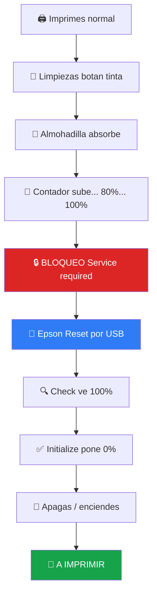
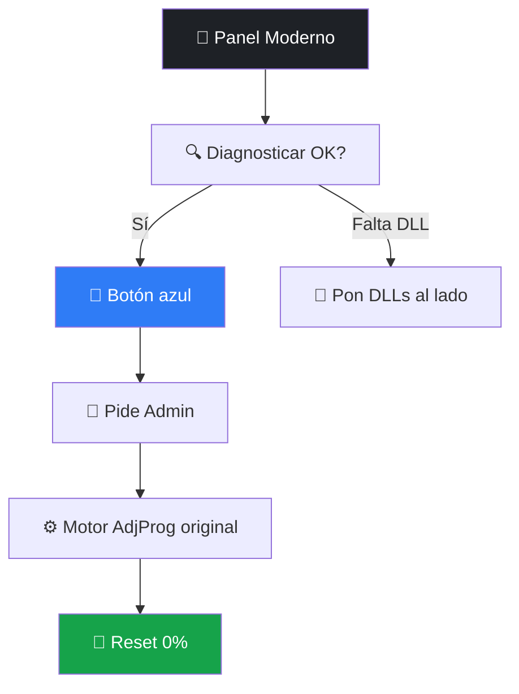

<div align="center">

# 🖨️✨ EPSON RESET ✨🖨️

## 🔧 Adjustment Program — Waste Ink Pad Counter Reset 🔧

### 🌱 EcoTank L1210 · L3210 · L3250 · L3251 · L3260 · L5290 RAW 🏢


[](https://github.github.com/gfm/)
[](https://pages.github.com/)
[](./)
[](https://github.com)


| 💡 Tinta / Papel parpadeando | 🛑 Service required | 🧽 Almohadilla llena |
|:---:|:---:|:---:|
| ✅ Se soluciona aquí | ✅ Se soluciona aquí | ✅ Se soluciona aquí |

> [!IMPORTANT]
> 💎 **¿Qué es esta aplicación?** Es el *Adjustment Program* que restablece el contador interno de tinta residual. Cuando tu Epson dice *"Se requiere servicio"* aunque tenga tinta, este programa lo desbloquea en minutos vía USB. 👇 *Sigue leyendo, te explico todo paso a paso.* 💙

</div>

---

## 📑 Índice 🗂️

- [❓ ¿De qué trata esta app?](#-de-qué-trata-esta-aplicación-)
- [🖨️ Modelos que incluye](#️-modelos-que-incluye-6-en-1-)
- [⚡ Inicio rápido 60 seg](#-inicio-rápido-60-segundos-)
- [📁 Qué hay en tu carpeta](#-qué-hay-en-tu-carpeta-)
- [🔌 Instalación y preparación](#-instalación-y-preparación-)
- [🚀 Uso paso a paso](#-uso-paso-a-paso-6-pasos-)
- [🖥️ Panel moderno v2](#️-panel-moderno-v200-)
- [🛠️ Fallos típicos](#️-si-algo-falla-tranquilo-tiene-arreglo-)
- [❓ FAQ](#-preguntas-frecuentes-)
- [🐙 GitHub](#-para-publicar-este-readme-en-github-)
- [📞 Ayuda](#-ayuda-y-contacto-)


## ❓ ¿De qué trata esta aplicación? 💡

<div align="center">

### 🧠 En una frase

**Tu Epson cuenta cuánta tinta bota al limpiar cabezales. Al llegar al 100% se bloquea. Esta app pone ese contador en 0%.** 🎯

</div>

| 🔴 Lo que ves | 🧠 Lo que pasa dentro | 🟢 Lo que hace la app |
|:---|:---|:---|
| 💡💡 Luces tinta + papel parpadean | 🧮 `Waste Ink Pad Counter = 100%` | 🔍 Lee el % con `Check` |
| 🛑 *"Service required"* | 🔒 Firmware bloquea impresión | ✅ Lo pone en `0%` con `Initialize` |
| 🧽 *"Almohadilla al final de su vida"* | 📦 EEPROM guarda el conteo | 🔌 Habla por `USB00x` a la EEPROM |



<details>
<summary>🔬 <b>Detalle técnico para curiosos (clic)</b></summary>

- 🧩 La app es `AdjProg.exe` 32-bit (MFC 2002-2007) + `apdadrv.dll` (habla USB vía SETUPAPI) + `StrGene.dll` (textos).
- 🖥️ En Win 64-bit corre sobre **WOW64** (emulación 32-bit). No existe "x64 nativo" sin código fuente — tu kit ya trae el parche `OSVer 4.0→6.0 + LAA` (`AdjProg_Win10_x64ready.exe`) y compat `WIN7RTM + RUNASADMIN + DPIUNAWARE`. ✅
- 💾 Escribe en la **EEPROM** de la impresora: `Main / Platen / Ink system pad counter → 0`.

</details>

> [!NOTE]
> 📝 Solo resetea el *contador lógico*. Si hay derrame físico real 💧, cambia la almohadilla o pon desfogue externo con tu técnico. 🔧

---

## 🖨️ Modelos que incluye 6 en 1 🎯

<div align="center">


</div>

| #️⃣ | 🖨️ Modelo | 🏷️ Tipo | 🖱️ Elige en Select | ✨ |
|:---:|:---|:---|:---:|:---:|
| 1️⃣ | **L1210** | 🌱 Solo imprime A4 EcoTank | `L1210` | ✅ |
| 2️⃣ | **L3210** | 🖨️ Imprime + Copia + Escanea | `L3210` | ✅ |
| 3️⃣ | **L3250** | 📶 + WiFi + WiFi Direct | `L3250` | ✅ |
| 4️⃣ | **L3251** | 🌎 Variante regional L3250 | `L3251` | ✅ |
| 5️⃣ | **L3260** | 🔄 + Dúplex automático | `L3260` | ✅ |
| 6️⃣ | **L5290** | 🏢 4 en 1 + ADF + Fax + Ethernet | `L5290` | ✅ |

> [!CAUTION]
> ⚠️ Elige tu modelo **exacto**. `L3250 ≠ L3251`. Si fallas dará `Communication Error`. Mira la etiqueta frontal o trasera. 🔍

---

## ⚡ Inicio rápido 60 segundos 🚀


1. 🔌 Conecta USB impresora → PC + enciende 🟢
2. 👑 Clic derecho app → **Ejecutar como administrador**
3. 🖱️ **Select** → tu modelo → puerto **USB00x** → OK
4. 🚀 **Particular Adjustment Mode** → **Waste Ink Pad Counter** → OK
5. ☑️☑️☑️ 3 casillas → **Check** → mira el % ⏳
6. ☑️☑️☑️ 3 casillas → **Initialize** → **OK** → **apaga impresora** 🔌 → **Finish** → 🎉 ¡Listo!

> 👇 *Abajo tienes cada paso explicado con dibujos y trucos.* 👇


## 📁 Qué hay en tu carpeta 📦

| 📄 Archivo | 🎯 Para qué sirve | 🖱️ Cómo se usa |
|:---|:---|:---|
| 🟦 `AdjProg.exe` | ⚙️ Motor original del reset | Clic derecho → Admin 👑 |
| ⚡ `AdjProg_Win10_x64ready.exe` | 🪟 Igual pero parcheado Win10/11 x64 | ✅ **Usa este** si el otro se cierra |
| 🚀 `INICIAR_AdjProg_Win8_10_x64.bat` | 🪄 Lanza todo con compat + admin solo | ✅✅ **Doble clic (recomendado)** |
| 🌙 `ABRIR_Panel_Moderno_v2.bat` | 🎨 Abre panel bonito oscuro WPF | Doble clic → botón azul |
| ⚙️ `AdjProg_Modern_Launcher.ps1` | 🧠 Código del panel moderno | Lo llama el .bat anterior |
| 🐍 `AdjProg_Modern.py` | 🐍 Panel alternativo tkinter | `python AdjProg_Modern.py` |
| 🧩 `apdadrv.dll` | 🔌 Habla con USB / impresora | ⚠️ Debe estar al lado del .exe |
| 🧩 `StrGene.dll` | 🔤 Textos del programa | ⚠️ Debe estar al lado del .exe |
| 🛡️ `Fix_Win8_10_x64.reg` | 📝 Aplica compat WIN7RTM + DPI off | Doble clic → Sí ✅ |
| 📘 `MANUAL_EPSON_RESET.md` | 📖 Manual completo Markdown | Léelo en GitHub 🌐 |
| 📕 `Manual_Usuario_Epson_Reset_L1210-L5290.pdf` | 🖨️ Manual para imprimir | Abre e imprime |
| 🌐 `Manual_Usuario_Epson_Reset.html` | 💻 Manual visual web | Abre en Chrome |
| 📝 `Manual_Usuario_Epson_Reset_FULL.txt` | 📋 Texto plano | Bloc de notas |

```console
📁 L1210, L3210... L5290 RAW 1.0.1.1/
├── 🚀 INICIAR_AdjProg_Win8_10_x64.bat  ← DOBLE CLIC AQUÍ
├── ⚡ AdjProg_Win10_x64ready.exe
├── 🟦 AdjProg.exe
├── 🧩 apdadrv.dll + StrGene.dll  ← NO LOS MUEVAS
└── 📘 README.md  ← ESTE ARCHIVO
```

> [!WARNING]
> 🚨 Si mueves el `.exe` sin sus `.dll` **se cerrará solo**. Siempre juntos en la misma carpeta. 📁🔒

---

## 🔌 Instalación y preparación 🛠️

### ✅ Checklist antes de empezar

- [x] 💻 Windows `7` / `8` / `8.1` / `10` / `11`
- [x] 🔌 Cable USB corto a puerto **USB 2.0 trasero** (no hub, no WiFi 📵)
- [x] 🟢 Impresora encendida + papel + sin cola de impresión
- [x] 🔕 Cerrar `Epson Status Monitor`
- [x] 🛡️ Carpeta en exclusiones del antivirus

<table>
<tr><td align="center" width="50%">

### 🔌 Paso A — USB

**Conecta el cable USB de tu impresora a la computadora** 🖨️➡️💻

Espera el 🔊 de Windows.

> 📵 Solo USB. WiFi **NO** sirve para resetear.

</td><td align="center" width="50%">

### 👑 Paso B — Admin

**Ejecuta la aplicación como Administrador** 🛡️

`Clic derecho → Ejecutar como administrador` 🖱️

> Sin admin falla `USB00x` ❌

</td></tr>
</table>

```batch
:: 🎯 Recomendado Win10/11: el .bat hace todo solo
INICIAR_AdjProg_Win8_10_x64.bat
:: Pide admin + pone WIN7RTM + desbloquea + abre el bueno ✅
```

<details>
<summary>🛡️ <b>¿Por qué pide administrador? (clic)</b></summary>

Porque necesita abrir el puerto USB físico 🔌, leer la EEPROM 💾 y tocar el spooler 🖨️. Sin admin Windows lo virtualiza y `apdadrv.dll` falla. Es normal y seguro. ✅

</details>


## 🚀 Uso paso a paso 6 pasos 🎬

<div align="center">


</div>

### 🥇 PASO 1 — USB + Admin 🔌👑

> Para usar la aplicación debes conectar el cable USB + ejecutar como Administrador. Sin esto nada funciona. 🔒

### 🥈 PASO 2 — Select + Modelo + Puerto 🖱️

> Presionar Botón **Select** y elegir el modelo Correspondiente. En Puerto elegir **USB00x**. 🎯

```text
┌──────────────────────────────┐
│ 🔧 Select Printer Model      │
│ Model: [ L3250      ▼ ] 🖨️  │
│ Port:  [ USB001     ▼ ] 🔌  │
│        [  OK  ] [ Cancel ]   │
└──────────────────────────────┘
```

```diff
+ ✅ Modelo exacto + USB001 = conecta
- ❌ Sin USB = revisa cable + driver + encendido
```

### 🥉 PASO 3 — Particular Adjustment Mode 🚀

> Pulsar sobre el botón **Particular Adjustment Mode**. 🖱️✨ Se abre la lista de mantenimiento. No toques lo demás. ⚠️

<div align="center">


</div>

### 🏅 PASO 4 — Waste Ink Pad Counter 🧽

> Seleccionar **Waste Ink Pad Counter** + OK. Verás `Main` + `Platen` + `Ink system`. ☑️

### 🔍 PASO 5 — 3 casillas + Check 📊

> Seleccionar las 3 casillas y pulsar **Check**. Esperar al porcentaje de vida. ⏳

- [x] ☑️☑️☑️ Marca las 3
- [x] 🔍 **Check** → sale `100%` 🔴 (normal, confirma bloqueo)
- [x] 🚫 No cierres ➡️ sigue al 6

### 🏆 PASO 6 — 3 casillas + Initialize + Apagado ✅

> Vuelve a seleccionar las 3 casillas y pulsa **Initialize**. Aparecerá un diálogo: presiona **OK**, **apaga tu impresora**, pulsa **Finish** y listo. 🎉

| #️⃣ | Acción | |
|:---:|:---|:---:|
| 1️⃣ | ☑️☑️☑️ de nuevo | ✅ |
| 2️⃣ | **Initialize** 🖱️ | ✅ |
| 3️⃣ | Diálogo **OK** 🆗 | ✅ |
| 4️⃣ | **Apaga impresora** 10 seg 🔌😴 | ⚠️ obligatorio |
| 5️⃣ | **Finish** 🏁 + prueba impresión 🖨️ | 🎉 |

> [!IMPORTANT]
> ✅ Haz `Check` otra vez: debe decir **0.00%**. Luces apagadas = ÉXITO. 🎊


## 🖥️ Panel moderno v2.0.0 🌙🎨

<div align="center">

### 🌙 ¿No te gusta lo retro? Usa el panel oscuro ✨

</div>

| 🖱️ Opción | 🎯 Qué hace |
|:---|:---|
| 🌙 `ABRIR_Panel_Moderno_v2.bat` | 🎨 Panel WPF oscuro nativo, título azul, tarjetas, botón azul, diagnóstico |
| 🔵 Botón **Iniciar modo secuencial** | 👑 Pide admin + aplica compat + abre motor original |
| 🔍 **Diagnosticar** | 🧪 Muestra EXE, admin, DLLs, versión 2.0.0 |
| 🛠️ **Aplicar compat** | ⚙️ Pone WIN7RTM + DPI off + RUNASADMIN |
| ❓ **Ayuda** | 💡 Recuerda: USB → botón azul → Select → Particular |

> El motor original (139 diálogos MFC) va por dentro intacto por estabilidad. El panel solo lo envuelve bonito. 💎



---

## 🛠️ Si algo falla tranquilo tiene arreglo 🆘

| 🔴 Problema | 🟢 Solución rápida | |
|:---|:---|:---:|
| 🔌 No sale USB00x | 🔄 Otro puerto 2.0 trasero + driver Epson oficial + admin | 🟢 fácil |
| 💥 Se cierra solo | ⚡ Usa `...x64ready.exe` o `.bat` + desbloquea + exclusión antivirus | 🟢 fácil |
| 📡 Communication error | 🖨️ Modelo mal en Select (L3250 ≠ L3251) | 🟡 medio |
| 0️⃣ 0% pero sigue error | 🔌 Initialize + apaga 15 seg + Finish + desconecta 1 min | 🟡 medio |
| 🔑 Pide key | ✅ Esta RAW no pide, usa el exe de tu carpeta | 🟢 fácil |
| ⬛ Ventanas negras | 🎨 `.bat` pone DPIUNAWARE solo | 🟡 medio |

<details>
<summary>🧰 <b>Comandos que te salvan (clic)</b></summary>

```powershell
# 🔄 Reiniciar impresión
Restart-Service Spooler

# 🔌 Ver tu puerto real
Get-Printer | Format-Table Name, PortName

# 🛡️ Desbloquear archivos
Unblock-File .\AdjProg.exe, .\apdadrv.dll, .\StrGene.dll
```

</details>


## ❓ Preguntas frecuentes 💬

<details open>
<summary>❓ <b>¿Cada cuánto se hace?</b></summary>
Solo cuando pida almohadilla llena (20-30 mil págs). 📄
</details>

<details>
<summary>📶 <b>¿WiFi sirve?</b></summary>
❌ No. Solo USB directo. 🔌
</details>

<details>
<summary>🪟 <b>¿Win 11 sirve?</b></summary>
✅ Sí, con admin + lanzador `.bat`. 👑
</details>

<details>
<summary>🛡️ <b>¿Pierdo garantía?</b></summary>
No daña, pero si está vigente consulta a Epson. 📞
</details>

<details>
<summary>🦠 <b>¿Antivirus lo borra?</b></summary>
Falso positivo común. Pon la carpeta en exclusiones. ✅
</details>

---

## 🐙 Para publicar este README en GitHub 🚀

<div align="center">


</div>

```text
📦 epson-reset/
├── 📘 README.md  ← ESTE ARCHIVO
├── 📄 *.pdf + 🌐 *.html + 📝 *.txt
├── 🖼️ docs/paso2-select.png ... (tus capturas)
└── ⚙️ .github/workflows/markdown-lint.yml
```

```yaml
# ⚙️ .github/workflows/markdown-lint.yml — valida solo
name: 📘 Lint README
on: [push, pull_request]
jobs:
  lint:
    runs-on: ubuntu-latest
    steps:
      - uses: actions/checkout@v4
      - uses: DavidAnson/markdownlint-cli2-action@v16
        with:
          globs: '**/*.md'
```

```bash
# 🚀 Subir
git init
git add README.md
git commit -m "📘 README Epson Reset 6 en 1 ✨"
git branch -M main
git remote add origin https://github.com/TU-USUARIO/epson-reset.git
git push -u origin main
# Luego Settings > Pages > main > /root 🌐
```

> [!TIP]
> 💡 En GitHub se animan solos: typing-svg ⌨️, mermaid 📊, badges 🏅 y alerts 📢. ✨

---

## 📞 Ayuda y contacto 💌🤝

<div align="center">

### 💬 Cualquier duda contáctanos y con gusto te ayudaremos 💙


| 📝 Cuéntanos | 📌 Ej |
|:---|:---|
| 1️⃣ Modelo | `L3250` 🖨️ |
| 2️⃣ Windows | `11` 🪟 |
| 3️⃣ Error | 📸 foto |

### 🏁 L1210 · L3210 · L3250 · L3251 · L3260 · L5290 RAW 🏁


*Gracias por usar Epson Reset* 🙏✨ · 📅 Octubre 2026 · 📘 GFM · 🐙 GitHub Ready

</div>
